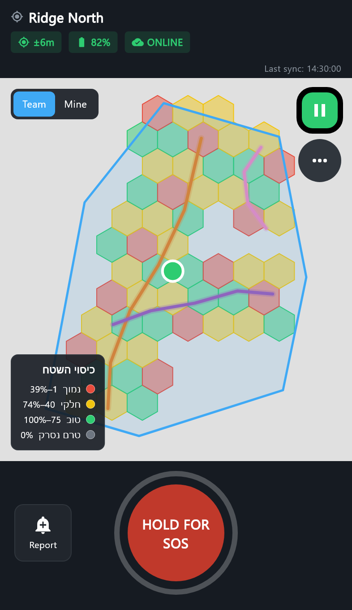
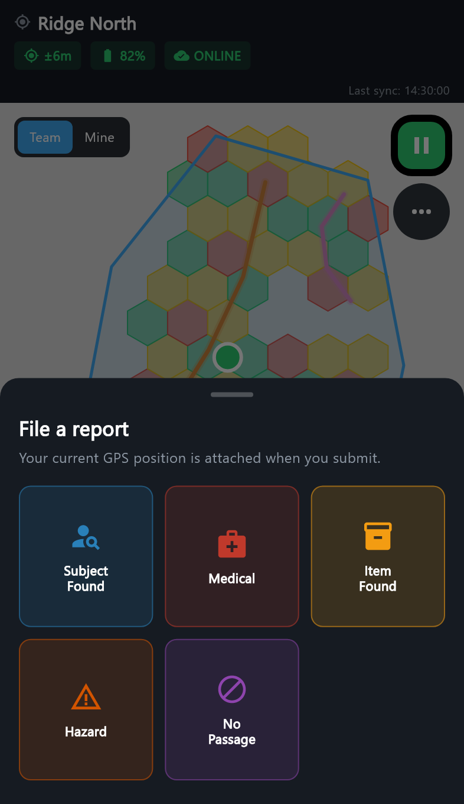
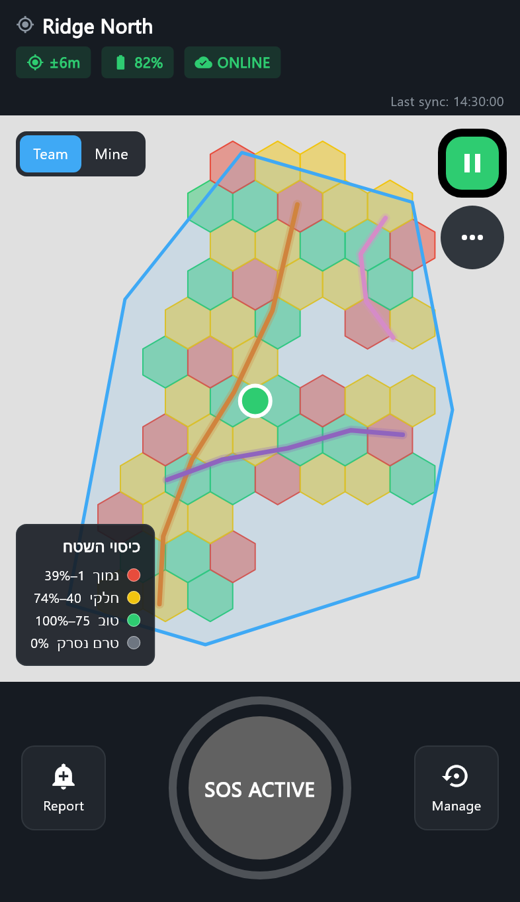

# FindResQ

FindResQ brings field volunteers and search coordinators onto the same map. Volunteers record where they searched, report findings and raise SOS alerts from a Flutter app. Coordinators divide an incident into sectors and follow team movement, search coverage and alerts from a web dashboard.

[How it works](#how-it-works) · [Run locally](#run-locally) · [Project layout](#project-layout)

## In the field

  
  
  

Team coverage, quick reporting, and an active SOS in a simulated search at Sacher Park, Jerusalem. Select any screenshot to view it full size. Base map © [OpenStreetMap contributors](https://www.openstreetmap.org/copyright).

## How it works

1. **Set up a search.** A coordinator creates an event, draws a sector on the dashboard, starts the event and generates a join code for that sector.
2. **Join and track.** Volunteers sign in with a one-time code, enter the sector join code and wait for approval. In the active session, tap **Start tracking** (▶) and grant location permission if prompted. The field map shows GPS accuracy, battery and sync status. **Team** displays shared coverage and tracks. **Mine** shows the volunteer's own trail.
3. **Turn GPS samples into coverage.** The app signs and encrypts location samples, queues them in SQLite and uploads them when the API is reachable. The server verifies the packets, groups usable points into track segments and estimates coverage in H3 hexagonal cells. Cell colors reflect estimated probability of detection based on the recorded passes through each cell.
4. **Report findings and respond to SOS.** Volunteers can file a GPS-tagged report or press and hold **SOS**. Authorized coordinators can acknowledge and resolve SOS alerts. The dashboard receives live updates when it is connected.

~~~mermaid
flowchart LR
    A["Flutter field app"] --> B["SQLite telemetry queue"]
    B -->|Sync| C["FastAPI"]
    A -->|SOS and reports| C
    C -->|Stores tracks and coverage| D["PostgreSQL / PostGIS"]
    C -->|WebSocket updates| E["Commander dashboard"]
~~~

**Connectivity:** GPS telemetry can queue offline. SOS and report submission currently require a connection to the API, and base map tiles require network access. BLE mesh relay is planned.

## Run locally

The example below uses PowerShell. You'll need Python 3.12, Docker with Compose, Flutter with Dart 3.12.2 or newer in the 3.x series, and the Android SDK with `adb` to run the field app on Android.

### Start the API and dashboard

For a first-time setup, run these commands from the repository root. Compose binds the development database port to `127.0.0.1`.

~~~powershell
cd backend
docker compose up -d --wait db

# Initialize a fresh development database once, in migration order.
Get-ChildItem .\migrations\*.sql | Sort-Object Name | ForEach-Object {
    Get-Content -Raw $_.FullName | docker compose exec -T db psql -v ON_ERROR_STOP=1 -U lifesearch -d lifesearch
    if ($LASTEXITCODE) { throw "Migration failed: $($_.Name)" }
}

py -3.12 -m venv .venv
.\.venv\Scripts\Activate.ps1
python -m pip install -r requirements.txt

if (-not (Test-Path -LiteralPath .env)) {
    Copy-Item -LiteralPath .env.example -Destination .env
}
~~~

If `backend/.env` is new, generate the two keys and paste the outputs into `JWT_SECRET` and `SECTOR_KEY_WRAP_SECRET`, respectively. Keep the existing keys when restarting an initialized environment.

~~~powershell
python -c "import secrets; print(secrets.token_urlsafe(64))"
python -c "import base64, secrets; print(base64.b64encode(secrets.token_bytes(32)).decode())"
~~~

Start the API from `backend/` with the virtual environment active.

~~~powershell
python -m uvicorn app.main:app --host 127.0.0.1 --port 8000
~~~

| Local entry point | What to use it for |
| --- | --- |
| [Commander dashboard](http://localhost:8000/dashboard/) | Create events and sectors, approve volunteers, and follow coverage and alerts. |
| [API documentation](http://localhost:8000/docs) | Inspect the API and try requests. |
| [Field simulator](http://localhost:8000/dashboard/sim.html) | Drive simulated search units through the ingest pipeline in local mode. |

With `ENV=local`, test OTP codes appear in the backend log. Keep this configuration and the simulator on a local development machine.

### Run the Flutter app

Connect an Android device or start an emulator. From the repository root in another terminal:

~~~powershell
cd mobile
flutter pub get
adb reverse tcp:8000 tcp:8000
flutter run
~~~

If the Android build fails while compiling libsodium on Windows, see the [Windows build notes](mobile/tool/ANDROID_BUILD_NOTES.md).

## Project layout

| Path | Contents |
| --- | --- |
| [`mobile/`](mobile/) | Flutter app, GPS sampling, local buffering, field map and alerts. |
| [`backend/app/`](backend/app/) | FastAPI, device and session auth, telemetry ingest and coverage logic. |
| [`backend/dashboard/`](backend/dashboard/) | Web dashboard and local simulator. |
| [`backend/migrations/`](backend/migrations/) | PostgreSQL/PostGIS schema and migrations. |
| [`backend/tests/`](backend/tests/) · [`mobile/test/`](mobile/test/) | Backend and Flutter tests. |
